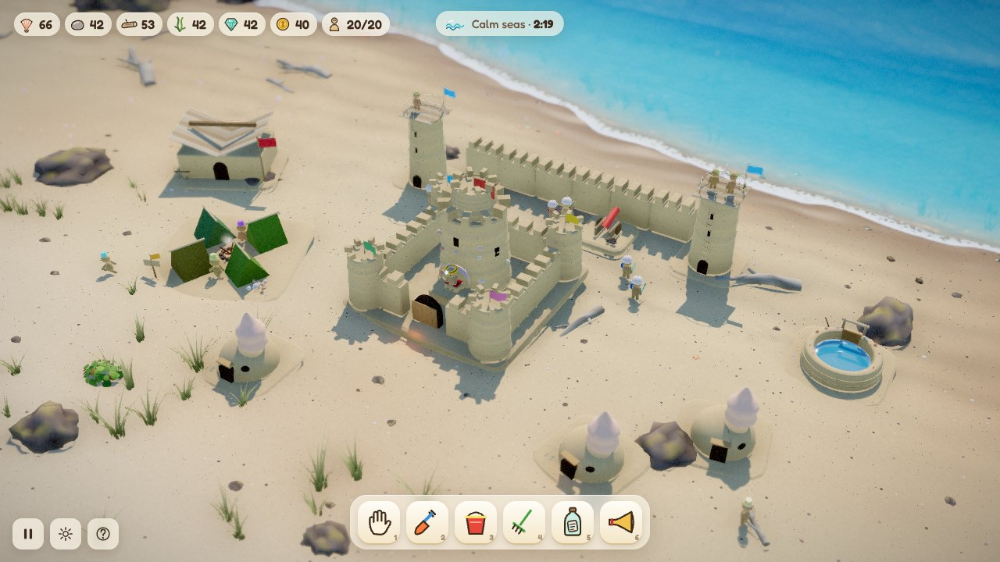
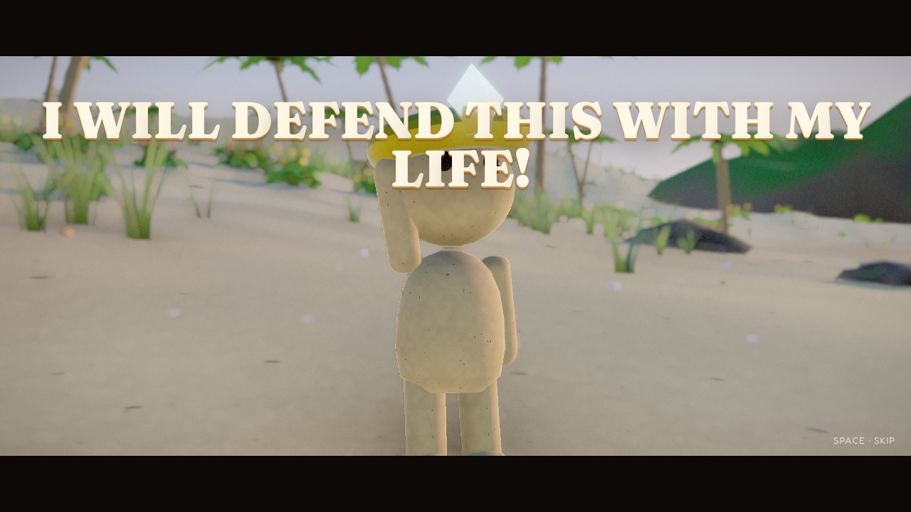
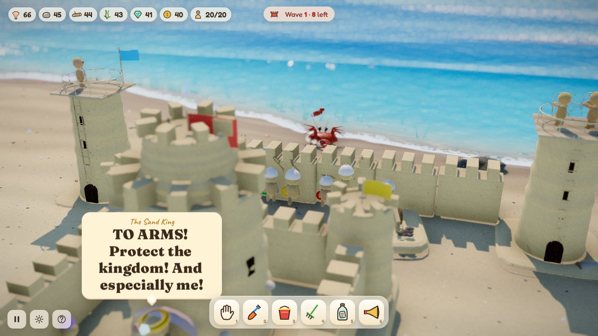
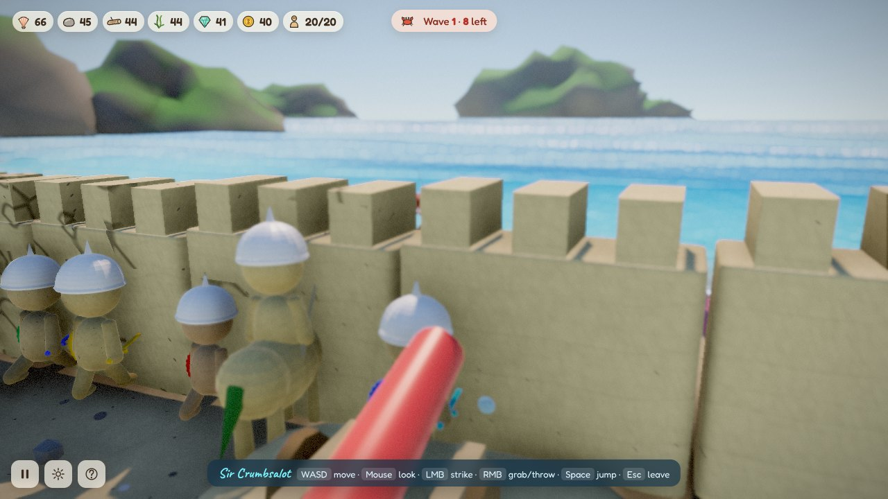
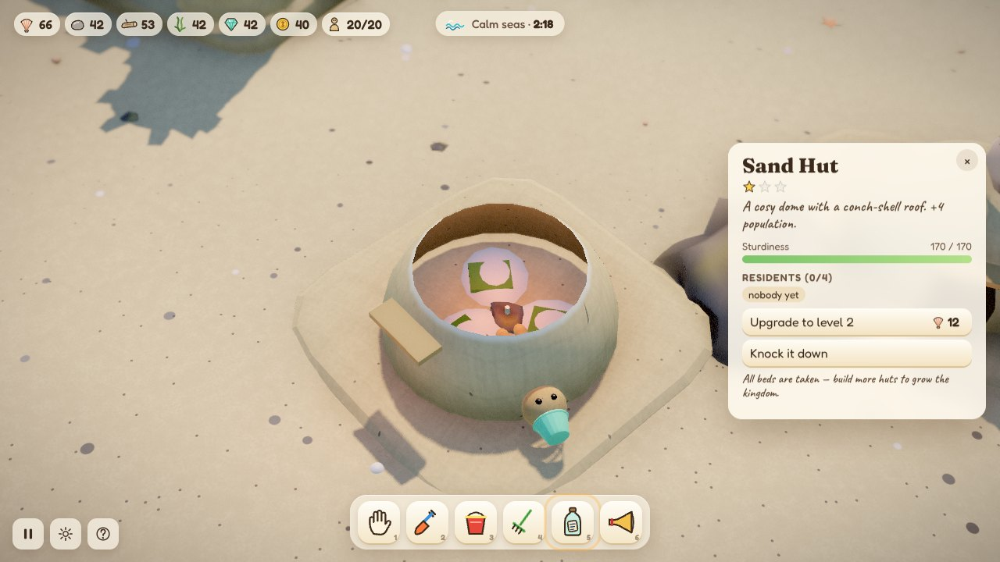
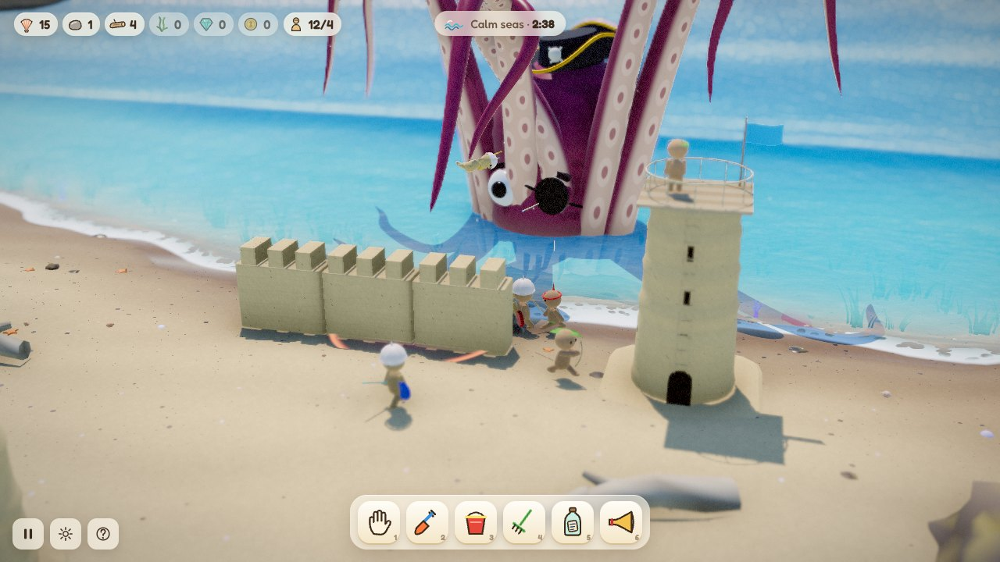

# Sandlings

**A miniature beach civilisation of tiny, goofy sand people defending their king, and his very important sandcastle, against the rising sea.**

You don't click menus to build. You dig trenches with a shovel, stamp towers with a bucket, pick up crabs and throw them into the surf, and hold the mouse on the sand to call workers over. The beach is a real simulation. Sand gets wet, slumps, piles up and washes away. Water runs down your moats, floods your canals and pounds your walls. Every few minutes a stopwatch washes ashore: **THE SEA WILL RISE IN…** Then the tide comes in with an army of cutlery-wielding crabs, and sometimes something much, much bigger.



---

## Play it

```bash
npm install
npm run dev
```

Open the address Vite prints (usually http://localhost:5173). You need a browser with WebGL2 (recent Chrome, Edge, Firefox or Safari) and a reasonably capable GPU. Sound starts after your first click, because browsers block audio until then. The buttons in the bottom-left corner pause the game, open the settings (graphics quality, depth of field, volumes) and show the controls.

```bash
npm run build      # static build in dist/, can be hosted anywhere
npm run preview    # serve the build locally
```

Useful URL options:

| Option | What it does |
| --- | --- |
| `?skip` | Skip the opening cinematic |
| `?low` | Lighter rendering for weaker GPUs (no ambient occlusion or depth of field, 1× pixel ratio) |
| `?debug` | FPS/sim overlay; <kbd>N</kbd> starts the next wave, <kbd>M</kbd> adds 50 of every resource |
| `?boss=kraken` / `?boss=kingcrab` | Puts that boss in the very first wave |
| `?fastwave` | Shorter wait before the first tide |

---

## How it plays

**The story so far.** A lone sandman, chased up the beach by a crab with a rusty fork, finds a lost wedding ring. He puts it on his head, declares *"I WILL DEFEND THIS WITH MY LIFE!"* and summons a tiny sandcastle. The crab retreats into the ocean to fetch its friends. You are now in charge of the Sand King.



**The tide cycle.**
1. **Calm seas.** Gather, build and grow. Shells, pebbles, driftwood, seaweed, sea glass and lost coins wash up all the time, and workers collect them on their own.
2. **The warning.** A giant stopwatch lands on the beach, its hands counting down to the rise. Click it to check the time.
3. **The rise.** The sea level climbs and big swells crash in, reshaping the beach. Crabs and sea creatures storm ashore. Every fifth wave brings a boss.
4. **The retreat.** The water falls back and leaves gifts: piles of resources, mysterious jars (treasure, shells, a new friend… or a crab), and **bottles with new blueprints** in them.

**Keep the King alive.** If the Sand King falls, the kingdom falls with him. He sits on his shell throne in the castle and stands up to fight if crabs reach him.



---

## Controls

### Camera
| Action | Input |
| --- | --- |
| Pan | <kbd>W</kbd><kbd>A</kbd><kbd>S</kbd><kbd>D</kbd> / arrow keys, or drag empty sand with the hand |
| Rotate / tilt | Right- or middle-drag, or <kbd>Q</kbd> / <kbd>E</kbd> |
| Zoom | Mouse wheel, or <kbd>R</kbd> / <kbd>F</kbd> |
| Pause | <kbd>P</kbd> |

### Tools (toolbar along the bottom, keys <kbd>1</kbd>–<kbd>6</kbd>)
| | Tool | Use |
| --- | --- | --- |
| 1 | **Hand** | Click a sandling to select it (<kbd>Shift</kbd>+drag to box-select). Click a building to zoom inside. **Grab and throw** sandlings, crabs, shells, rocks and boulders. **Hold the mouse on the sand** to summon workers there. With soldiers selected, click or hold to send them. |
| 2 | **Shovel** | Drag to dig trenches and moats; the spoil piles up beside the cut. Right-drag (or <kbd>Shift</kbd>+drag) to heap sand. |
| 3 | **Bucket** | Click to stamp a wet-sand bucket tower; click it again to stack it higher. |
| 4 | **Rake** | Drag to smooth and level the beach. |
| 5 | **Blueprints** (<kbd>B</kbd>) | Open the bottle rack and pick a building, then click to place it. <kbd>R</kbd> rotates, walls are dragged as a line, <kbd>Shift</kbd> keeps placing, <kbd>Esc</kbd> or right-click cancels. |
| 6 | **War horn** | Click to rally your soldiers (or just the selected ones) to a spot. |

### Possession: be a sandling
**Right-click any sandling** to drop into third person.

| Action | Input |
| --- | --- |
| Move / sprint | <kbd>W</kbd><kbd>A</kbd><kbd>S</kbd><kbd>D</kbd> / <kbd>Shift</kbd> |
| Look | Mouse |
| Strike or shoot | Left mouse |
| Grab and throw (crabs, items, other sandlings) | Right mouse |
| Jump | <kbd>Space</kbd> |
| Dragons | Hold left mouse to breathe fire; <kbd>Space</kbd> / <kbd>C</kbd> to climb and dive |
| Leave | <kbd>Esc</kbd> |

With soldiers selected, right-click the ground to send them there.



---

## The kingdom

Click any building to zoom inside like a dollhouse. Its walls are cut away so you can watch the inhabitants sleeping, chatting or training, and see its upgrades and what it does.



| Building | What it's for |
| --- | --- |
| **The King's Castle** | Home of the king and his throne. Trains workers, stores resources, researches kingdom upgrades. |
| **Worker Camp** | Seaweed tents around a driftwood fire. Houses 4, trains workers, stores what they gather. |
| **Sand Hut** | A cosy dome with a conch roof: +4 population. |
| **Sand Wall** | Drag to raise a crenellated wall. Holds back crabs and small waves. |
| **Bucket Tower** | Stamped with the bucket tool, stacked up to three high. |
| **Archer Tower** | Archers garrison on top and shoot toothpicks at anything with claws. |
| **Barracks** | Trains toothpick knights and spear sandlings. |
| **Pebble Cannon** | Paper-straw barrel; fires pebbles that knock crabs flying and dent the beach. |
| **Spoon Catapult** | A wooden spoon and a rubber band. Lobs rocks far into the surf. |
| **Rock Shelter** | Sandlings hide inside instead of turning to mush when the sea rises. |
| **Driftwood Bridge** | Lets sandlings cross your trenches and moats. |
| **Toothpick Trap** | Hidden in the sand. Crabs hate it. |
| **Tide Reservoir** | Fills with sea water at high tide. **Open the sluice** to send a flash flood down your trenches and wash crabs away. |
| **Seahorse Stable** | Trains Shell Riders on sand-sculpted seahorses. |
| **Dragon Roost** | Hatches tiny sand dragons that breathe fire. |

Most blueprints aren't available at the start. They wash ashore in bottles after each tide.

**Units:** workers, knights, spear sandlings, archers, Shell Riders (cavalry) and sand dragons. Each needs a bed, so build huts and camps to grow. Every building upgrades twice. The castle researches *Sharper Toothpicks*, *Bottle-cap Armour*, *Long Twig Bows*, *Wet-sand Mortar* and *Flip-flop Training*.

Sandlings are little physics ragdolls. They stumble, get knocked flat, carry heavy driftwood together, cheer when a wave is beaten and panic when it isn't. In a heavy hit they lose arms, legs and occasionally heads, revealing a cross-section of very fine sand.

---

## The sea and what lives in it

| Enemy | Notes |
| --- | --- |
| **Fork Crab** | The rank and file. |
| **Butter-knife Crab** | Small and fast. |
| **Spoon Crab** | Blocks arrows with its spoon. |
| **Tin-can Hermit** | Armoured; smashes buildings. |
| **Lobster Brute** | Grabs sandlings and throws them. |
| **Pistol Shrimp** | Shoots bubbles from range. |
| **Sir Pinchington, Lord of the Fork** | A giant crab with a trident. Stomps, sweeps and calls reinforcements. *(Waves 5, 15, …)* |
| **Old Inkbeard, Terror of the Shallows** | The Kraken. Six huge arms slam the beach, snatch sandlings to fling or swallow, sweep the shoreline, and slap the sea into tidal waves. Hack at an arm while it lies on the sand to sever it; only archers, siege and dragons can reach the head. *(Waves 10, 20, …)* |



---

## Under the hood

Everything you see is generated in code: terrain, water, buildings, sandlings, crabs, the Kraken, props, music and voices. There are no external art or sound assets apart from three web fonts.

- **Rendering:** [three.js](https://threejs.org) r186 and [pmndrs/postprocessing](https://github.com/pmndrs/postprocessing): ACES tone mapping, depth of field (for the tilt-shift miniature look), bloom, N8AO ambient occlusion, a colour grade and vignette. Custom shader injections give wet sand, foam, caustics, wind-swept foliage and building cutaways. A day/night cycle has a painterly sky and a storm that rolls in with the Kraken.
- **Beach simulation:** a 256×192 heightfield on the CPU.
  - Shallow-water flow with virtual pipes, including offshore wave injection, swash, infiltration and tides.
  - Sediment erosion, transport and deposition.
  - Angle-of-repose slumping that depends on how wet the sand is.
  - Drying over time.
  - Buildings block the water and get eroded by it.
- **Bodies:** Verlet ragdolls with pose targets, buoyancy, breakable constraints and dismemberment. Crabs walk on procedural two-bone-IK legs. The Kraken's arms are length-preserving spines rebuilt every frame as dynamic tubes.
- **Audio:** procedural Web Audio: formant "babble" voices, generative music that follows the tide, positional effects.

```
src/
  core/        engine, input, camera rig, maths, noise, events
  world/       beach simulation, terrain/water meshes, sky, props, particles
  entities/    sandlings, crabs, the Kraken, dragons, items, projectiles, ragdolls
  buildings/   catalogue, procedural models, materials, building logic
  game/        game loop, economy, worker/combat AI, interaction tools, possession, wave director, tutorial
  ui/          floating typography, inspection cards, blueprint rack, icons
  audio/       procedural sound and music
  cinematic/   the opening cinematic
```
